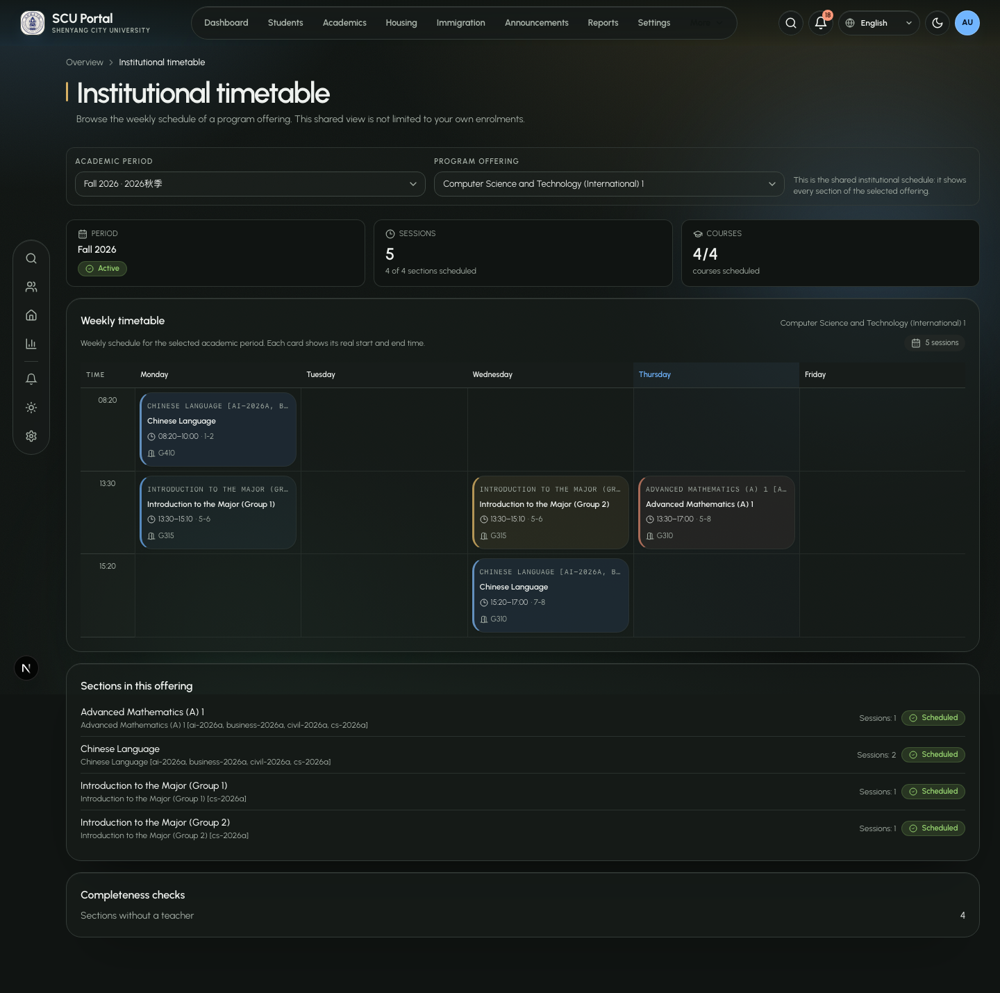
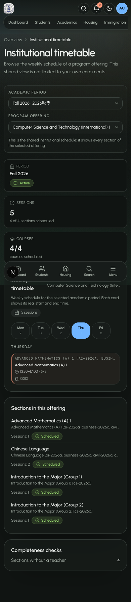
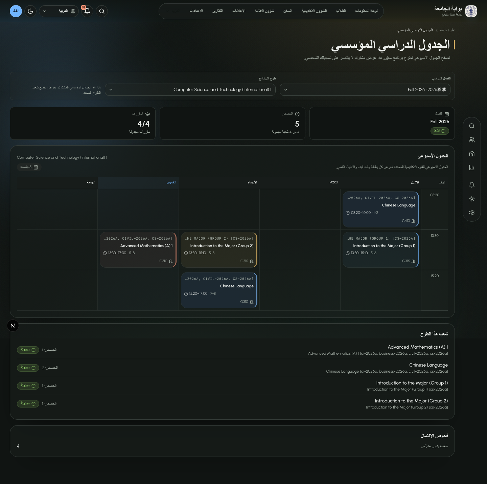
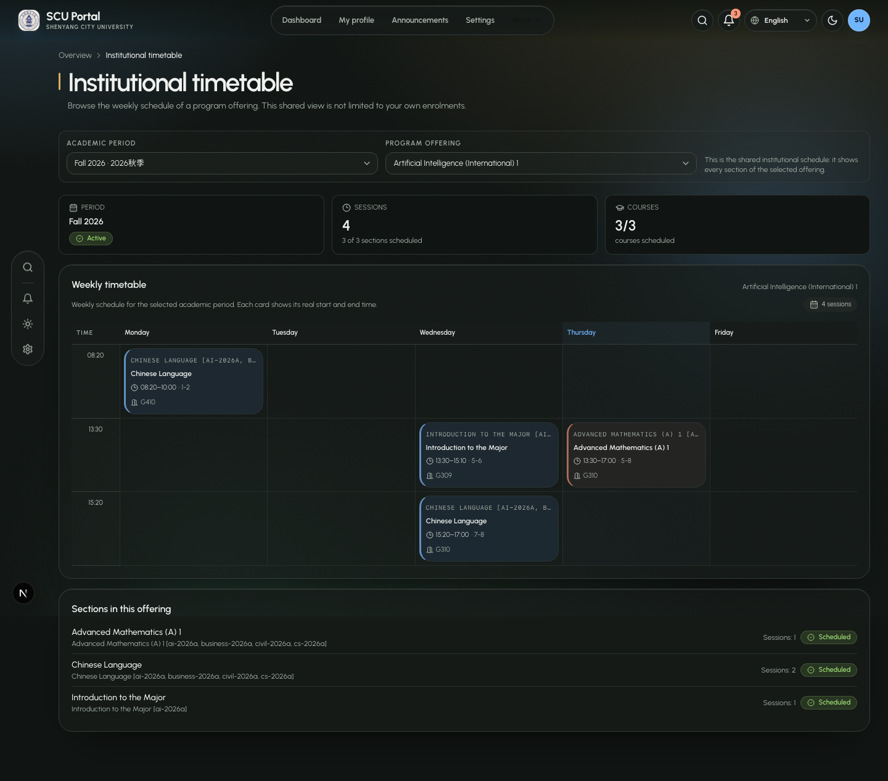
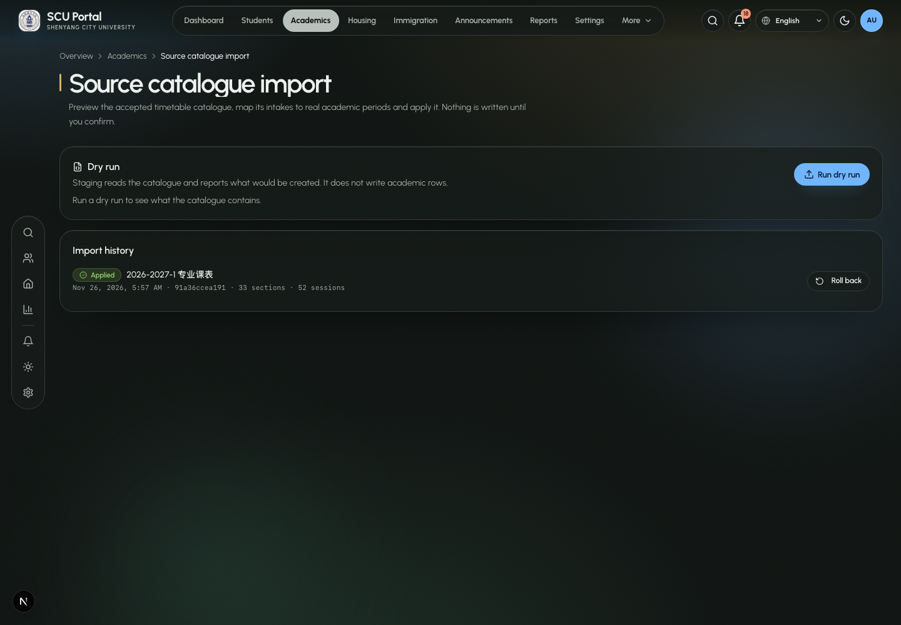
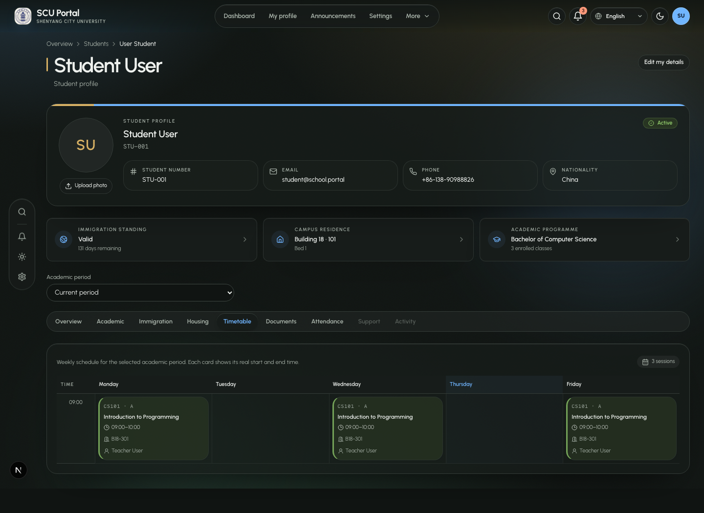
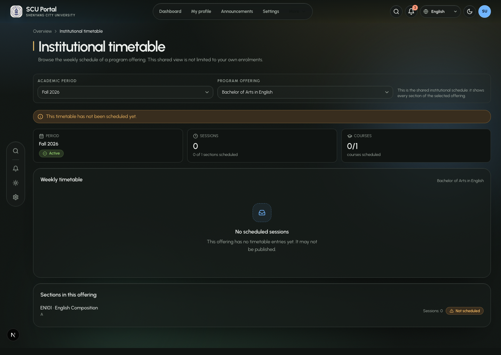
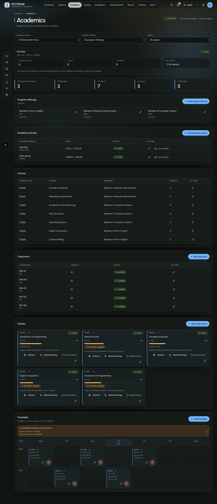

# SYCUMAIN V3 — Timetable Functional Completion Report

Date: 2026-11-26
Baseline: `8467300` (`feat: activate migrated accounts instead of issuing passwords`), branch `main`
Scope: timetable functionality, source-catalogue import, completeness reporting, navigation/access, late-enrolment authorization
Status: **implemented and verified locally; not deployed, not migrated against real data, nothing staged or committed**

---

## 1. Verdict

The phase fulfils its acceptance criteria in the local stack:

1. V3 now has a real shared institutional timetable at `/app/timetable`, comparable in purpose and core usability to `https://sycu-timetable.vercel.app/` (period + offering selection, weekly grid, day/time/course/room blocks, section list, mobile day agenda).
2. The institutional view is filtered by **period + program offering only**. Enrollment is never consulted; a test and a live run both show the demo student seeing sessions she is not enrolled in.
3. The existing personalised timetable is untouched in behaviour and still resolves only the student's own offering/enrollments (screenshot 06).
4. Teacher scoping is intact: the demo teacher's `/academics/timetable` returns 5 sessions belonging to their 2 assigned sections, and importing is denied.
5. The previously unexposed catalogue importer is now a coherent, permission-gated **preview → apply → rollback** workflow.
6. Incomplete timetables are identified: staff get reconciliation findings in Academics and per-offering diagnostics; students get a plain "incomplete / not scheduled" notice with no internal diagnostics.
7. Late enrolment in an earlier intake requires an Admin/Management decision recorded on the enrollment (approver, timestamp, reason, optional reference), enforced by the service, not the UI.
8. V3's intake-based architecture, permissions, audit trail and five-locale support are preserved; V1 was not touched.

The one honest caveat is in §11: V3 still has no explicit "published" flag, so "incomplete" is derived from data completeness rather than from a publication act.

---

## 2. The two timetable experiences

| | Institutional (new) | Personalised (existing) |
|---|---|---|
| Route | `/app/timetable` | `/app/students/{id}?tab=timetable`, reached by students via `/app/profile?tab=timetable` |
| API | `GET /api/v1/academics/institutional-timetable?program_offering_id=…&period_id=…` | `GET /api/v1/academics/students/{id}/timetable` (unchanged) |
| Filter | selected period + selected offering | the student's visible sections (offering ∩ enrollments, then enrollments narrow the offering) |
| Shows courses the viewer is not enrolled in | **yes, by design** | no |
| Viewer-dependent data | only the staff diagnostics block | the whole result |
| Write access | none for students/teachers | none |

The two are separate routes, separate API endpoints and separate components. Neither reuses the other's filtering rules, so there is no ambiguous "sometimes personal" timetable.

Teacher timetable:

| | Teacher (existing) |
|---|---|
| API | `GET /api/v1/academics/timetable` (role-scoped) |
| Filter | sections the teacher is assigned to |
| Live check | 5 sessions across CS101-A and BA101-A (the teacher's 2 assigned sections) |

---

## 3. T1 — Period and offering resolution corrected

### Before

`/app/academics` built its selector from `docs/scu-timetable-domain-map.json` through `/academics/source-intakes`. All three source intakes resolved to `period: null, configured: false` because no writer of `ref:v1:period:*` / `ref:v1:offering:*` was reachable. Choosing an intake produced an empty classes/timetable card while source-only offerings still rendered — the reported defect.

### After

- The Academics selector lists **operational academic periods** (`listPeriods`), defaulting to the `ACTIVE` one. No catalogue record can be selected as if it were a period.
- Period → offerings → classes → timetable all resolve from the same `period_id`; the page's summary panel reports the selected period's own counts.
- The catalogue's role changed from selector to **context**: `selectedIntake` is derived by matching `intake.period.id === selectedPeriod.id`. If the period has no catalogue mapping, the panel says "Not imported" and points at the import console. It no longer presents an empty timetable as if it were the period's schedule.
- Stable identifiers: `academic_periods.id` / `program_offerings.id` for reads; `ref:v1:period:*` / `ref:v1:offering:*` source keys written only by the importer, on explicitly mapped existing periods.
- No duplicate periods or offerings are created: the importer **requires** an existing period id per source semester, and it looks up offerings by `source_key` before inserting.
- Historical/future isolation is unchanged: the institutional endpoint requires the offering to belong to the requested period (`PROGRAM_OFFERING_NOT_FOUND` otherwise), and the existing period-scope rules still gate the personalised views.

The three intakes remain "not imported" until an operator maps and applies them; that is now visible, actionable state rather than a silent empty schedule.

---

## 4. T2 — Unified, authorised import workflow

The existing importer (`app/services/academic_import.py`) was reused unchanged in its core: `prepare_import`, `apply_import`, `rollback_batch`, with their source-key lookups, `_validate_timetable_slot` checks and the timetable advisory lock. What was missing was a request surface and duplicate protection.

### API (all `academic.manage_periods`; Admin and Management only)

| Method | Path | Effect |
|---|---|---|
| `POST` | `/api/v1/academics/imports/preview` | stages the catalogue into `academic_import_batches/rows`; writes no academic rows |
| `GET` | `/api/v1/academics/imports` | recent batches |
| `GET` | `/api/v1/academics/imports/{id}` | one dry-run report |
| `POST` | `/api/v1/academics/imports/{id}/apply` | requires `confirm: true` + explicit `period_map`; transactional |
| `POST` | `/api/v1/academics/imports/{id}/rollback` | removes only rows owned by that batch, restores mapped period metadata |

Service additions are thin and additive:

- `preview_import` returns the applied batch (`already_applied: true`) instead of creating a second batch for the same source checksum.
- `apply_import` now refuses to apply when **another applied batch** has the same SHA-256 — one applied batch per source file, so rollback is never ambiguous.
- `batch_report` reads staging rows only: counts by entity/action, source periods with their mapping, and held rows with error codes.
- Router audits `academic.import.previewed`, `.applied`, `.rolled_back` with the actor, SHA, mapping and counts.

### UI — `/app/academics/import`

- "Run dry run" stages and shows: status, source name/SHA, counts (periods, offerings, courses, rooms, sections, sessions), held records with codes, and one target-period select per source intake (`Leave unmapped` = skip).
- Apply is disabled until the reviewer ticks the confirmation sentence; the API independently rejects `confirm != true` with `IMPORT_CONFIRMATION_REQUIRED`.
- Import history lists batches with status, counts and a Roll back button for applied batches.
- Period suggestions in the selects come from **dates** (year + spring/autumn half-year), not from names, and remain editable/clearable.

### Live run (development stack, then reverted)

| Step | Result |
|---|---|
| Baseline | 2 periods, 3 offerings, 7 courses, 5 sections, 5 entries, 51 enrollments |
| Preview | `READY`: 3 periods, 15 offerings, 26 courses, 11 rooms, 33 sections, 52 sessions, 76 raw rows; 8 held rows (N103 conflict) |
| Apply `{2026-autumn → Fall 2026}` | `APPLIED`: `applied_periods 1`, `applied_offerings 6`, `applied_sections 9`; totals 14 sections / 19 entries |
| Institutional, "Computer Science and Technology (International) 1" | 5 sessions, 4/4 courses scheduled, 4 sections — screenshot 01 |
| Rollback | `ROLLED_BACK`; totals returned exactly to 5 sections / 5 entries / 3 offerings / 7 courses; `academic_periods.source_key` count back to 0 |

No other academic rows were touched by the rollback (verified by the counts above).

---

## 5. T3 — Completeness and reconciliation

Staff surface (unchanged report, newly surfaced):

- The Academics timetable card now renders `GET /academics/timetable/reconciliation` for the selected period: "6 timetable findings need attention" with per-code counts (`SECTIONS_WITHOUT_TEACHER`, `SECTIONS_WITHOUT_TIMETABLE`) — screenshot 08.
- The institutional endpoint returns `readiness.issues` **only** when the caller holds `academic.manage_timetable`: sections without sessions, sections without a teacher, sessions without a room, period not mapped to source.
- Reconciliation remains accurate: with the seeded data it still reports `REVIEW`, 6 warnings, 0 blocking.

Student surface:

- `readiness.status` (`COMPLETE`/`INCOMPLETE`) plus a `message_code` drives one plain banner:
  - `TIMETABLE_PARTIALLY_SCHEDULED` → "some sections have no scheduled sessions yet" plus "n of m sections have scheduled sessions";
  - `TIMETABLE_NOT_SCHEDULED` → "this timetable has not been scheduled yet" (screenshot 07);
  - `TIMETABLE_NO_SECTIONS` → no sections to show.
- The student response contains **no** issue list, no section ids and no administrative wording. Verified live: the student payload returned `issues: []` while the admin payload for the same offering returned three findings.

No incomplete timetable is presented as complete, and no new "publish" model was invented.

---

## 6. T4 — Institutional weekly timetable

`/app/timetable` is a destination, not another card on Academics:

- Period and program offering selects, defaulting to the active period and its first offering.
- Header stats: sessions, "x of y sections scheduled", "courses scheduled / total".
- `WeeklyTimetable` reused as-is: real start/end times, official start-time rows, course colour by code, room, teacher names, day columns, and the mobile day-selector agenda.
- Section list below the grid: course code/name, section label, teachers, session count, scheduled/not-scheduled badge — this is how an incomplete offering stays legible on a phone.
- Staff-only "Completeness checks" card for the selected offering.
- Empty states distinguish no periods, no offerings, no sessions, and an incomplete/unpublished schedule.

Live composition during the import run (screenshot 01): Chinese Language (Mon 08:20, Wed 15:20), Introduction to the Major Group 1 (Tue 13:30), Group 2 (Wed 13:30), Advanced Mathematics (Thu 13:30) — shared sections appear once in the offering's schedule, not duplicated per program.

Visual conventions were preserved (existing card/grid/badge components, dark theme, `border-s-*` course accents); nothing was restyled wholesale.

---

## 7. T5 — Navigation and access

Navigation (`src/lib/navigation.ts`):

- **Institutional timetable** — `/app/timetable`, `academic.view`, all roles; placed first in the academic group so students can discover it.
- **My timetable** — `/app/profile?tab=timetable`, students only; `/app/profile` now forwards the `tab` parameter, so a student reaches the personalised view without knowing their UUID.
- **Academics** — unchanged staff-only entry (hidden for students), now clearly a curriculum/administration console with links to the institutional timetable and the import console.

Access control (not merely hidden links):

- `/app/academics` redirects students to `/app/timetable` client-side, while every endpoint it uses keeps its own permission checks.
- `GET /academics/institutional-timetable` requires `academic.view`: read-only for all four roles, no writes exist on the endpoint.
- Import endpoints require `academic.manage_periods`; verified 403 for student and teacher.
- `GET /academics/timetable` keeps its role scoping; teacher sees only assigned sections.
- `GET /academics/students/{id}/timetable` keeps its ownership check: a student requesting another student's timetable gets 404 (not 403), so existence is not leaked.

Role matrix (live, local):

| Role | Institutional timetable | Personal/teacher timetable | Academics console | Import |
|---|---|---|---|---|
| Admin | 200 + diagnostics | unrestricted admin list | 200 | 200 |
| Management | 200 + diagnostics | unrestricted admin list | 200 | 200 |
| Teacher | 200, no diagnostics | 5 sessions / 2 assigned sections | 200 (read-only where unpermitted) | 403 |
| Student | 200, no diagnostics | own 3 sessions only; other student 404 | redirected | 403 |

---

## 8. Late-enrolment authorization

Rule: joining a section whose period starts before the current active period, or is already `COMPLETED`, is a late enrolment. It requires an Admin or Management decision and a recorded reason.

Enforcement is in `services/academic.py::_late_enrollment_authorization`, called by `enroll_student` **before any write**:

1. resolve the section's period and the current active period (`resolve_period`);
2. if not an earlier/completed intake → unchanged behaviour;
3. otherwise require role `ADMIN` or `MANAGEMENT` → `403 EARLIER_INTAKE_NOT_AUTHORIZED`;
4. require a trimmed reason of at least 10 characters → `400 EARLIER_INTAKE_REASON_REQUIRED`;
5. store `authorization_reason`, `authorization_reference`, `authorized_by_id` (FK `users.id`), `authorized_at` on the enrollment row (new and re-enrolled rows);
6. the route audits `academic.enrollment.created` with `late_authorized` and the reason.

The codes reuse the institution's already-reserved vocabulary (`EARLIER_INTAKE_NOT_AUTHORIZED`, `EARLIER_INTAKE_REASON_REQUIRED`) whose translations already existed, so the client message is localised without new error codes.

Tests cover: reason missing, reason too short, authorised by Management with full record, teacher denied, and a current-intake enrolment still succeeding without authorization. No silent historical enrolment path exists: the check is inside the only service that can create enrollments.

---

## 9. Multilingual and RTL

- New namespaces `institutionalTimetable` and `academicImport`, plus `navigation.timetable`, `navigation.myTimetable`, and new `academics.*` keys, in **en, zh, fr, ru, ar**.
- Nine new API error codes have messages in all five locales.
- No hardcoded user-facing strings were added; the pages use `useTranslations` exclusively.
- Arabic renders right-to-left correctly (screenshot 03): selects, grid columns, section list and stats mirror, and the native `<select>` keeps logical order.
- `pnpm i18n:check`: 2,658 keys per locale, no missing/extra keys, 145 dynamic keys resolve, 225 backend codes have messages.

---

## 10. Verification actually run

### Backend (pytest, isolated test database `:5434/school_portal_test_v2`)

| Command | Result |
|---|---|
| `pytest tests/test_institutional_timetable.py` | **13 passed** |
| `pytest tests/test_academic.py tests/test_academic_import.py tests/test_institutional_timetable.py` | **66 passed, 1 skipped** (60.7 s) |
| `pytest tests/test_academic_period_scope.py tests/test_intake_and_timetable.py tests/test_source_intakes.py` | **18 passed** (24.3 s) |
| `alembic check` (API container, after migration + index fix) | **No new upgrade operations detected** |

New test module covers: student sees an un-enrolled section's session in the offering schedule; teacher can browse but gets no diagnostics; staff diagnostics include unscheduled sections; unknown offering 404; student timetable write 403; import 403 for student/teacher; preview counts 33 sections and writes no sections; unconfirmed apply 400; apply with one mapped period; duplicate preview returns the applied batch; rollback restores period key and removes batch-owned sections; Management preview 200; late-enrolment matrix above.

### Frontend

| Command | Result |
|---|---|
| `pnpm typecheck` (`tsc --noEmit`) | pass, no output |
| `pnpm lint` (`next lint`) | no errors (one pre-existing `no-page-custom-font` warning in `layout.tsx`) |
| `pnpm i18n:check` | pass for 5 locales |

### Live workflow (development stack `:3101` / `:8001` / `:5435`)

Authenticated `curl` plus Playwright screenshots at 1440×1000 and 390×844:

1. preview → apply → browse imported CS&T offering → rollback (numbers in §4);
2. student institutional view during the applied state (5 sessions, courses she is not enrolled in);
3. student institutional view after rollback (incomplete notice, 0/1 sections);
4. student personalised timetable (3 CS101 sessions, unchanged);
5. Arabic RTL institutional view;
6. import console and Academics reconciliation banner.

Screenshots (`docs/evidence/timetable-completion/`):










Database state after the demonstration: the applied rows were rolled back; academic counts are back to the baseline (2 periods, 3 offerings, 7 courses, 5 sections, 5 entries, 51 enrollments, no period source keys). Two import-bookkeeping batches remain in the dev database (one staged `READY` from the dry run, one `ROLLED_BACK`); they contain no academic rows and are the provenance trail, not data.

---

## 11. Remaining defects and unverified behaviour

1. **No explicit publication flag.** "Incomplete" is derived from whether sections have sessions. There is no "publish timetable" act, so a complete schedule is implicitly published and an incomplete one is implicitly not. Closing this needs a product decision (offer-level `published_at`), which the previous investigation recommended and this phase did not invent.
2. **Imported sections have no teachers.** The source catalogue carries no teacher names, so every imported section is flagged `SECTIONS_WITHOUT_TEACHER` until assignments are made. This is accurate, not a bug, but it means an imported timetable is always "incomplete" by the current definition.
3. **Two source sections remain held** by the unresolved N103 conflict (2 sections / 4 sessions), as designed by the importer. They are visible in the dry-run report and cannot be applied until the conflict is resolved.
4. **Imported offerings have no parent program** unless `parent_program_map` is supplied. The API accepts the map; the import UI does not expose a program picker. Offerings are therefore listed under their period but not under a program in program-centric views.
5. **Period mapping is per apply, not persisted.** After rollback, an operator must map the source intake again. This is deliberate (no inferred dates), but it is operational friction.
6. **No late-enrolment UI.** The web app still has no enrolment form; the rule is enforced on the only endpoint that creates enrollments, and the API client now carries the reason/reference fields. A future enrolment screen must collect them.
7. **UI verification is visual, not automated.** Typecheck/lint/i18n and the backend contract are automated; the new pages were inspected via Playwright screenshots and live API calls, but no Playwright spec was added for them.
8. **Screenshot method.** The in-app browser panel is narrow, so the desktop screenshots were captured with the repository's Playwright Chromium at 1440×1000; the mobile ones at 390×844.
9. **Student redirect is client-side.** `/app/academics` renders nothing for a student and redirects; the server still authorises every underlying endpoint. A server-side route guard would remove the brief flash.

---

## 12. Database and migration impact

One additive migration:

`apps/api/alembic/versions/f3b7c2d9e6a1_late_enrollment_authorization.py` (`down_revision = d1e4a7b9c2f5`)

- `enrollments.authorization_reason` — `Text`, nullable
- `enrollments.authorization_reference` — `String(200)`, nullable
- `enrollments.authorized_by_id` — `UUID`, nullable, FK → `users.id`
- `enrollments.authorized_at` — `timestamptz`, nullable
- index `ix_enrollments_authorized_by_id`

No rows are created, updated or deleted by the migration. Existing 51 enrollments keep `NULL`, which correctly says "no recorded authorization" rather than inventing an approver. `downgrade()` drops the index, the FK and the four columns. Applied to the development database; `alembic check` is clean.

No other schema change: the importer already had its batch/row tables, and no second timetable source was introduced.

---

## 13. Exact Git changes

HEAD is unchanged at `8467300`. **Nothing is staged, committed or pushed.** The working tree already contained 115 uncommitted entries from earlier phases; this phase adds the following.

Modified (15 paths):

```
apps/api/app/models/academic.py                     |  29 +-
apps/api/app/routers/academic.py                    | 318 +++++++++-
apps/api/app/schemas/academic.py                    | 116 ++++
apps/api/app/services/academic.py                   | 276 +++++++-
apps/api/app/services/academic_import.py            | 150 +++-
apps/web/messages/{ar,en,fr,ru,zh}.json             | 133 each
apps/web/src/app/[locale]/(protected)/app/academics/page.tsx   | 323 +++---
apps/web/src/app/[locale]/(protected)/app/profile/page.tsx     |  14 +-
apps/web/src/lib/academic-api.ts                    |  73 ++-
apps/web/src/lib/navigation.ts                      |  19 +
apps/web/src/types/academic.ts                      | 106 ++++
```

New (untracked):

```
apps/api/alembic/versions/f3b7c2d9e6a1_late_enrollment_authorization.py   (63 lines)
apps/api/tests/test_institutional_timetable.py                            (392 lines)
apps/web/src/app/[locale]/(protected)/app/timetable/page.tsx             (323 lines)
apps/web/src/app/[locale]/(protected)/app/academics/import/page.tsx      (427 lines)
docs/evidence/timetable-completion/                                       (8 screenshots)
docs/v3-timetable-functional-completion-report.md                         (this report)
```

Pre-existing untracked work from earlier phases (other migrations, mail models, evidence folders, the comparison report) was left untouched.

Protections honoured: V1 not opened or modified; no database reset or deletion; no real institutional data migrated; no deployment; no commit/push; no permission or audit weakening; no new dependency; no duplicate academic model.

---

## 14. What an authorization to proceed would cover

Deployment, commit/push and any real-catalogue apply remain explicitly out of scope until authorised. The natural next decisions are:

1. whether to introduce an explicit offering-level publication act (closing §11.1);
2. whether the import UI should also map source offerings to parent programs (§11.4);
3. whether to resolve the N103 conflict in the source map so the two held sections can be imported.
